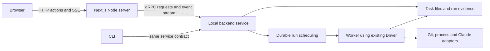

# ADR 0003: A local backend service shared by Next.js and the CLI

Status: accepted for the first local-server slice (2026-11-16); later migration steps remain planned.

Implemented: native gRPC reads/actions, shared composition, Effect 3 worker fibers/semaphore and spans, durable accepted run records, one worker, shared task locks, CLI forwarding, bounded progress-tail reads, persistent cost/log evidence, backend-owned diagnostics/team operations and structured web actions. `factory serve` uses the same lifecycle as the backend app. `pnpm backend` starts the service; `pnpm web` starts/reuses it. See [the operational guide](../local-backend.md).

Deferred: streamed progress/SSE, generated record types beyond the JSON snapshot envelope, automatic crash/step recovery, cancellation, log rotation, pagination and GitHub operation reconciliation. Progress uses the existing page refresh. No HTTP-versus-gRPC performance advantage is claimed.

## Context

Before this migration, `factory serve` was a health endpoint only. Next.js ran a new CLI process for each read and action, and started long-running work as detached CLI processes with PID files. This shares workflow rules but disperses lifecycle ownership across HTTP requests, files and processes. Faster CLI startup helps, but it cannot provide a durable queue, coordinated cancellation or recovery after a crash.

The driver already depends on ports and has no dependency on Next.js or HTTP. Keep that boundary and the CLI interface. The service is the execution owner; the CLI becomes another client when the service is running. This targets the user's local Mac and filesystem, not a cloud deployment of a privileged repository worker.

## Proposed topology

The browser does not call native gRPC. Use a server-only client in the Next.js Node runtime, shared across requests. Relay the backend event stream through a Next.js route as SSE. The Node gRPC API supports unary and streaming methods; browser gRPC-Web uses a separate client/proxy path that this topology does not require. See the official [Node tutorial](https://grpc.io/docs/languages/node/basics/) and [gRPC-Web tutorial](https://grpc.io/docs/platforms/web/basics/).

The Next.js server and backend must run on the same local machine for loopback communication. A remotely deployed Next.js app cannot reach the user's Mac through its own `localhost`.

## Transport options

| Option | Benefits | Costs | Fit |
| --- | --- | --- | --- |
| CLI subprocess bridge | Existing interface and process isolation | Startup per read, detached lifecycle, file polling | Keep while migrating |
| Local HTTP JSON plus SSE | Existing Zod schemas, straightforward debugging, familiar Next.js integration | Maintain request types and streaming conventions | Lowest-complexity default |
| Local native gRPC between Node servers | Explicit versioned service contract, streaming, status codes and deadlines | Proto tooling/types, client lifecycle, translation to domain/Zod objects | Reasonable if typed RPC and streaming are desired |
| In-process Next.js driver | Removes transport | Ties privileged long-running work to development reloads and web lifecycle | Reject as execution owner |

Either HTTP or gRPC eliminates process startup per read. There is no measured evidence here that protobuf serialization would materially improve this workload; model calls, shell commands and repeated process creation dominate the observed design. gRPC is a contract and streaming choice, not a prerequisite for a persistent backend.

Given the user's interest in gRPC, make it the first transport spike, with HTTP JSON/SSE as the comparison. Evaluate `@grpc/grpc-js` with generated TypeScript types on the pinned Node version before adopting it. Use a persistent channel and a versioned `factory.v1` service. Start on loopback TCP for simple tooling; a Unix socket with restricted directory permissions is an optional local-only alternative whose gRPC compatibility must be verified in the spike. [Node IPC reference](https://nodejs.org/api/net.html#ipc-support).

## Service boundary and API

Extract CLI composition into shared application services without moving policy into transport handlers. Both the CLI and backend adapt requests to the same services; the existing pure core, injected driver and adapters stay intact. Validate transport inputs and stored records, including project/task identity, even with generated protobuf types.

Initial methods:

- `GetHealth`, `ListProjects`, paginated `ListTasks`, `GetTask`, `GetGate`, bounded `GetDiff`.
- `SubmitTask`, `StartRun`, `ReviseTask`, `ApproveTask`, `RejectTask`, `OpenPullRequest`.
- `GetRun`, `WatchRun(after_sequence)`, and later `CancelRun` when cancellation owns the full process tree.

Long-running requests return a run identifier immediately after durable acceptance. Submitting a run does not hold an RPC open for minutes. `WatchRun` streams sequenced events, stage changes and bounded log chunks, with replay from an offset and a retention-gap response. A disconnected UI stops its subscription; it must not implicitly cancel paid work.

Use request IDs/idempotency keys for mutations and distinguish invalid input, conflict/busy, missing task and service unavailable. A deadline on a client request does not prove the mutation did not happen: query the accepted operation before retrying. Never automatically retry push/PR creation without reconciliation. Approval continues to require the exact reviewed head, and the driver rechecks all existing gates before pushing.

## Ownership, storage and recovery

1. One service instance owns a data root. All worker and direct CLI mutations honor the same task locks during migration; per-task exclusion lasts for the entire run, not just individual file writes. Start with one worker globally, then allow a measured limit across projects. Coordinate repo-level branch/worktree administration before parallelizing tasks in one repository.
2. Task JSON remains authoritative for stage, verdict, approval and results. Durable run records contain accepted command, task identity, operation ID, arguments, lifecycle and log offsets. Persist acceptance before acknowledging it. Run records coordinate execution; they do not mirror task domain decisions.
3. No new database is necessary for the first single-worker implementation. If indexing or queue transactions warrant SQLite later, define recovery and authority first; task summaries can be a rebuildable index, never competing task state.
4. On restart, identify interrupted runs and expose recovery actions. Do not automatically replay an uncertain model/tool step or a push. Only reclaim ownership after establishing that previous workers and their process trees have stopped. PID checks alone cannot establish ownership across PID reuse.
5. Each worker owns its SDK request and subprocess group. Add abort propagation, per-step limits, bounded logs with rotation, and graceful shutdown: stop accepting work, stop scheduling, drain or deliberately interrupt active work, persist the outcome, release ownership. Killing only `/bin/sh` is insufficient if checks started descendants.
6. Reconnectable events and explicit operation state replace `web-run.json` and whole-file log polling. Keep full logs as artifacts, read tails by byte offset, and apply backpressure and retention limits.

Bind locally, validate allowed hosts/origins at the HTTP boundary, and require a local service credential for privileged RPCs; do not assume a loopback port alone identifies the caller. Keep secrets out of URLs and rendered pages. Repository profiles and all approval rules remain enforced in application services.

## Migration and acceptance criteria

1. **Contract spike:** implement health, task read and a synthetic event stream over gRPC. Verify Node compatibility, channel reuse under Next dev reload, deadline/error mapping, browser SSE relay, slow consumers and reconnect offsets. Compare representative read latency/RSS against a persistent HTTP handler and the optimized CLI, using realistic task counts. This step must not invoke models.
2. **Shared services:** extract composition and centralize command-stage preconditions. Contract-test CLI and service responses using the same temporary task store. Keep the CLI usable for setup and read-only diagnosis.
3. **Read migration:** switch the Next.js server bridge to the chosen transport. Preserve existing page contracts; ensure one task page does not independently request the same record several times. Verify no CLI processes spawn for web reads.
4. **Execution ownership:** add durable acceptance, the single worker, shared exclusion and operation reconciliation. Route web and CLI mutations through the service; fail clearly when it is unavailable rather than silently falling back to a competing execution owner. An explicit offline mode requires proving the service is stopped.
5. **Progress and recovery:** migrate logs and background state to streams, then add cancellation and interrupted-run recovery. Exercise crashes during acceptance, model execution, commit, verification and PR creation, and disconnect/reconnect during a stream.
6. **Rollout:** retain the old bridge until parity tests pass; then remove detached web workers. Update `.plain` specifications, OpenAPI/transport contracts, startup scripts, README and operational recovery instructions together.

Accept the migration only when two concurrent starts produce one accepted run, a lost client response cannot duplicate work, all approval/head checks match CLI behavior, slow subscribers cannot exhaust memory, service restart reports interrupted work honestly, and shutdown leaves no unowned verification processes.

## Consequences

A persistent backend fits the product's growing execution needs and removes the repeated process boundary from reads. It adds a process to supervise, durable scheduling semantics, transport compatibility and an explicit recovery policy. Preserve the CLI as a useful client and the driver as transport-independent orchestration. Adopting gRPC can be a good fit, but should not delay fixing ownership and interrupted work, which are the harder problems.
