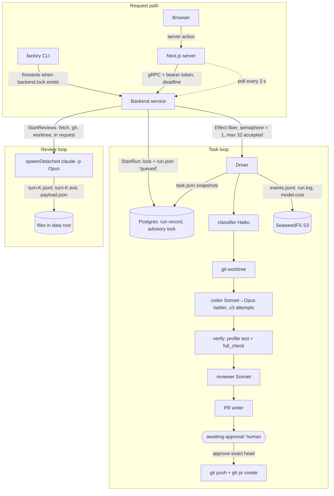

# Agent execution review: Software Factory against an asynchronous work tier

Status: analysis, 2026-11-17. No code was changed. Evidence is cited as `path:line` or by symbol. **[Inferred]** marks a conclusion that the code suggests but does not prove.

The system: a local, single-user factory on one Mac. It turns a task prompt into a reviewed commit and a pull request (the **task loop**), and it runs senior PR reviews as chats (the **review loop**). The users are the owner (web app and `factory` CLI) and, through pull requests, the owner's GitHub team. ADR 0003 and ADR 0004 scope it explicitly: one machine, one worker, no cloud deployment.

## 1. Summary

- **The two agent loops use two different execution models.** Task runs go through a durable acceptance record, a Postgres advisory lock and one in-process Effect worker. PR reviews are detached `claude -p` processes with state in plain files, outside the queue, the lock, the trace and the cost ledger.
- **Request isolation is good for tasks and partial for reviews.** `StartRun` returns after it writes the run record, and the web polls every 3 s. `StartReviews` does `git fetch --all`, GitHub calls and worktree creation inside the request.
- **Acceptance is durable, execution is not.** A run that is queued or running when the backend stops is reported `interrupted` and is never resumed. A task left in `coding` or `reviewing` needs manual repair of its record.
- **Step checkpoints exist at the task level, but not inside a step.** The verdict, worktree, verification and review are saved and skipped on a rerun. A killed coder step loses all its work (`persistSession: false`), and its cost is not recorded.
- **There is no cost bound per run.** One `run` can make up to 3 coder calls of 200 turns each, plus a reviewer and a PR writer. Reviews use Opus with no turn or money limit. TODO.md records a $5.37 task. The SDK already offers `maxBudgetUsd` and `abortController`, and the code uses neither.
- **The review agent has the most power and the fewest controls.** It runs with `--dangerously-skip-permissions`, without the OS sandbox and the tool guard that the coder has, and the skill lets it post to GitHub when the user asks.
- **For this scale, a durable-workflow engine is not the right next step.** The current design with Postgres plus a small set of additions (a step journal, abort, budgets, one shared provider limit, reviews moved under the backend) closes most of the gaps.

## 2. Current-state map

**Observed.** The trigger is always a human: a web action or a CLI command. There is no event, schedule or webhook trigger. Results are delivered by polling: `AutoRefresh` every 3 s for tasks, and a 3 s `fetch` in `review-chat.tsx` for reviews. The task loop always stops at the human gate. Only `openPr` writes outside the machine.

## 3. Property-by-property assessment

| Property | Current state (observed) | Gap and risk | Recommendation | Size |
| --- | --- | --- | --- | --- |
| 1. Latency and failure isolation | `StartRun` persists the run, forks a fiber and returns (`service.ts` `start`). The backend is a separate process from Next.js (ADR 0003). The web never falls back to a competing worker. | `ReviewService.start` runs `fetchAllPrune`, `gh` GraphQL, `addWorktreeAt` and `resetWorktreeHard` for up to 20 PRs serially inside one RPC. A slow remote or a stale ref lock blocks the request until the client deadline, and the work may still finish afterwards with no record of who asked. | Accept a review batch durably, return at once, and prepare worktrees in the worker. | M |
| 2. Durable execution | The run record (`queued`/`running`/`completed`/`failed`) is written before the RPC returns. `drain()` on SIGTERM stops acceptance and waits for active runs. Task stage and step results are in `task.json`. | Work lives in a fiber. On a crash, queued and running runs become `interrupted`. Nothing re-enqueues them, and the task can stay in `coding` (`docs/local-backend.md` "Interruption and recovery"). `drain()` waits without a time limit, so a stuck model call blocks the shutdown for ever. Reviews are not drained: detached agents outlive the backend **[inferred: this is intended, so reviews survive restarts]**. | On startup, reconcile: mark stale runs `interrupted`, set `coding`/`reviewing` tasks to a resumable stage, and re-enqueue runs that were only `queued`. Give drain a deadline that aborts the active model call and records the abort. | M |
| 3. Backpressure and rate limiting | One task worker, up to 32 accepted runs. Up to 6 running reviews per project, counted from files. The only automatic model retries are a rate limit with no activity (adapter) and one retry of an agent turn that ended with no result (driver, `result-retry.ts`; resumes the saved session, recorded as `retried: 'no-result'` on the attempt and as a `retry` event). | The two limits are independent: one coder plus 6 reviews per project all use the same Claude account at the same time. The review count is check-then-act across PRs, so concurrent `start` calls can exceed 6 **[inferred from `guard` being per PR]**. A usage-limit error fails the step, and the task must be resumed by hand (TODO.md). | Use one provider semaphore that both loops share (tasks and reviews), with a global limit. Classify "rate limited" and "usage limit" errors, and re-queue with a delay at the failed step instead of failing the task. | M |
| 4. Stage decomposition | The driver is a fixed sequence of steps, each saving its output in `task.json`. `run` skips classify and worktree when they exist. `revise` restarts at the coder. Verification is idempotent and checks the head SHA. | A step cannot retry alone from the backend. The only entry points are `run` and `revise`, and `run` rejects most stages through `taskCommandBlockers`. A reviewer failure after a passing verification needs `factory task review` with the backend stopped. There is no fan-out: work is linear, which fits a single repo and one worker. | Add a "resume at step" command that the backend can schedule, based on the stage and the saved step outputs. Fan-out is not needed now. | S–M |
| 5. Decoupling through events | `withEvent` appends domain events to the task record. `events.jsonl` records spans and logs. | The events are a record, not a bus. Nothing listens to them. New behavior (notify on `awaiting-approval`, start a review when a PR opens) means a change in the driver or the UI. ADR 0003 plans `WatchRun` streams, but they are deferred. | When the first listener is needed, add a Postgres outbox table (written in the same transaction as the task snapshot) and `LISTEN/NOTIFY`. Do not add a broker. | S (when needed) |
| 6. Observability across steps | Each run has one Effect trace. Each model call is a `model.run` child span with `model.cost` events, written to S3 in sequence (`evidence.ts`). Prompts and model output are kept out of the trace on purpose. | The trace ends at the process: reviews have no trace and no cost record. There is no tool-call span inside a model step, so a 40-minute coder call is one opaque span. A run that is interrupted has a `span.start` without a `span.end`. There is no exporter, so traces can be read only as files. | Put reviews under `Evidence`, and parse the `total_cost_usd` in their stream result into `model.cost`. Record tool-use events (the runner's `onProgress` already sees them) as span events. | S |

**Why the current choices** (from the ADRs). One worker and no automatic replay were deliberate: ADR 0003 says "Do not automatically replay an uncertain model/tool step or a push", and that PID checks cannot prove ownership. That is correct for a privileged worker that pushes to GitHub. The recommendations above keep that rule: they make resumption explicit and step-scoped, not automatic for side effects.

## 4. Agent-specific concerns

**Retry semantics.** Observed: there is no automatic retry of a model call (`docs/local-backend.md`). The ladder is a planned retry: after a failed verification, the next coder attempt runs on a stronger rung, with the check output as feedback. The coder works on top of the previous attempt's commit, so the work is not redone. Saved step outputs (verdict, verification, review, PR draft) are checkpoints, and `run` skips the first two. Gaps: a coder or reviewer killed mid-call loses its session (`persistSession: false`), and a rerun pays again from zero. Writes are mostly idempotent: the worktree creation refuses an existing path, `stageAll` + `commit` runs only after the call, and verification checks that the head did not change. The one write that is not idempotent is `openPr`. If `push` and `gh pr create` succeed and the task write then fails, a retry creates a second PR or fails (`docs/backend-performance-review.md` item 8). Recommendation: before `gh pr create`, look for an open PR for the branch (`gh pr list --head`) and adopt it.

**Long-running calls.** Observed: `runner.run` has no timeout, heartbeat or abort. The SDK `Options.abortController` (sdk.d.ts line 1643) is not used. A coder call can take up to 200 turns. Profile commands in `verify` have no `timeoutMs`. On drain, the backend waits for the call to end. On SIGKILL, the SDK subprocess and any check processes can stay alive, holding the worktree (ADR 0003 point 5). Stall detection: a review is `interrupted` only when its PID is gone. A hung but living agent stays `running`, and counts against the limit of 6 for ever. Recommendation: one `AbortController` per step, a wall-clock limit per step from the profile, a no-progress timeout based on the last tool event, and `timeoutMs` plus process-group kill for verification commands.

**Cost control.** Observed: costs are recorded per attempt and per model call. Unknown costs stay `null`, and billed failures keep their cost. Context is bounded in places: the reviewer diff is capped at 200,000 characters, the PR writer at 80,000 characters, and check output at 6,000. Gaps: there is no budget for a step, a run or a task. The worst case for one `run` is 3 coder calls of 200 turns each (the last one on Opus) plus a 60-turn reviewer and a 30-turn PR writer. Reviews run Opus with no `--max-turns` and no budget, and every follow-up message resumes the full session. A 200,000-character diff is about 50,000 tokens on every reviewer call **[inferred: ~4 characters per token]**. Recommendation: pass `maxBudgetUsd` (sdk.d.ts line 2050) per step, and enforce a per-task budget in the driver from the sum of `attempts[].cost_usd` before each ladder climb (the TODO item). For reviews, add a per-turn limit to the CLI arguments and record the cost.

**Concurrency per provider.** Observed: everything uses one Claude sign-in. Task steps are serialized by the semaphore. Reviews are limited to 6 per project, and the limit is not shared with tasks or across projects. There is no handling for rate limits: a 429 or a usage-limit error becomes a failed step. Recommendation: see property 3. One shared limit, and errors classified into "retry later at this step" and "fail".

**Human in the loop.** Observed: this is the strongest part of the design. `run` ends at `awaiting-approval`. The worker is released, and the task waits in Postgres with no process held. `approve` requires at least 7 characters of the exact reviewed head SHA, and `openPr` checks the gates again before the push (`approvalBlockers`, `openPrBlockers`). Blocking findings need an explicit `--accept-blocking`. Gaps: the human is not notified. They see the state only when they open the page. A Fable rung that `requires_human_approval` is filtered out, not offered for approval.

**Tool calls and side effects.** Observed, task loop: the coder has Read, Grep, Glob, Edit, Write and Bash, inside an OS sandbox (writes only in the worktree and package caches, network only to registry.npmjs.org) and behind a guard that blocks forbidden commands and paths. The driver, not the model, does the commit, and it reverts staged forbidden paths. Pushing and opening PRs happen only after human approval. Review loop: the agent runs `claude -p --dangerously-skip-permissions` with no sandbox and no guard, in a worktree it can reset. Its skill says that it never posts to GitHub on its own, but that is a prompt rule, not a control. It runs `tests_on_base.sh`, which changes the working tree and restores it on exit. A killed review can leave that tree changed **[inferred]**, and the next review start runs `resetWorktreeHard`, which cleans it up. Partial failure cleanup: a failed worktree creation is removed. A failed coder leaves its uncommitted changes in the worktree for the next attempt. Nothing else is compensated, and nothing else needs to be, until `openPr`.

**Observability.** Observed: an on-call person (here, the owner) can follow one task run in `run.json`, `run.log` and `events.jsonl`, with one trace ID and per-call cost, and the task page shows the attempts and errors. The `interrupted` state tells the truth about a dead run. Gaps: a review can be followed only through its stream-json log, with no trace, no cost and no exit reason other than the exit code. Tool steps inside a model call are not in the trace. There is no rotation, so logs grow without limit.

**Evaluation.** Observed: output quality is checked by layers. Zod validates every structured output (verdict, review, PR draft, review payload). The repository's own test and full-check commands verify the code. A second model reviews it, and a human approves the exact commit. The review payload renderer refuses a payload without confidence or a post-merge signal. Gaps: there is no offline evaluation of the prompts or the ladder. A change to `definitions/prompts/*.md` or to a rung has no test set, and no metric (pass rate per rung, cost per passed task, reviewer findings later confirmed by the human) is computed from the attempts the system already saves.

## 5. Execution-model comparison

What this system needs: one machine, one owner, 1 task worker, ≤ 6 reviews, tens of runs a day **[inferred from the 28 commits and the single-user ADRs]**; steps that take minutes to an hour; a human pause that can last days; one external side effect (push + PR) that must never repeat; Postgres already running; local Claude sign-in and repositories on the host.

| Need | Queue + workers (BullMQ, pg-boss) | Durable-workflow engine (Temporal, Inngest, Trigger.dev) | Current design + additions |
| --- | --- | --- | --- |
| Survive a crash and continue | Job retries the whole job unless you split it | Replays the workflow and skips finished activities | Step journal in Postgres + startup reconciliation |
| Long human pause | Job ends; a new job starts on approval | Native (`waitForSignal`) with no held worker | Already works: the task waits in Postgres |
| No repeated model spend | Must checkpoint by hand | Activity results are saved, but a killed activity is retried from zero, so a 40-minute coder call is re-spent | Same as the engine, plus SDK `resume` if sessions are kept |
| Never repeat the PR | Idempotency key by hand | Idempotency key by hand (activities are at-least-once) | Reconcile before `gh pr create` |
| Provider concurrency | Per-queue limit, built in | Per-task-queue limit, built in | One shared semaphore |
| Operational cost | Redis for BullMQ; pg-boss uses the existing Postgres | A server cluster (Temporal) or a hosted service that must reach the Mac's repositories and Claude sign-in | Nothing new |

The engine's main benefit, automatic replay of a long workflow, is the part that this system deliberately does not want for uncertain model calls and pushes (ADR 0003). Its other benefits (signals, timers, step history) are already covered, or cheap to add, at this scale. A hosted engine (Inngest, Trigger.dev) also runs code away from the machine that holds the repositories and the sign-in, which ADR 0003 and ADR 0004 rule out. Recommendation: keep the current model and add a Postgres step journal. If more parallelism is needed later, **pg-boss** gives a queue with delays, retries and concurrency limits on the existing database. Look again at Temporal only if runs move off one machine, or if workflows get fan-out with many steps.

## 6. Top 5 recommendations (risk reduced per unit of effort)

1. **Abort, deadlines and stall detection for every agent step (S).** Pass an `AbortController` and a wall-clock limit to the SDK, add `timeoutMs` and process-group kill to verification commands, and mark a review `stalled` after N minutes with no new stream line. This removes the shutdown that never ends and the review slot that is held for ever.
2. **Per-step and per-task budgets (S).** `maxBudgetUsd` per step, a task budget checked before each ladder climb, and a turn limit for review turns. This removes the case where one task spends without limit.
3. **Bring reviews under the backend's controls (M).** Accept a review batch durably and return at once. Count running reviews in one place, together with tasks, under one provider limit. Record their cost and trace. Run them with a sandbox and a tool guard that allows `gh` reads but blocks `gh pr review`, `gh pr comment` and `gh api -X POST` unless the user's message asks to post. This removes the most powerful process that has the fewest controls.
4. **Startup reconciliation and resume at a step (M).** On start: mark stale runs, move `coding`/`reviewing` tasks to a resumable stage, re-enqueue runs that never started, and let the backend schedule "resume at reviewer" (and "retry after usage limit" with a delay). This removes the manual repair of task records.
5. **Idempotent PR opening (S).** Before `gh pr create`, look up an open PR for `factory/<id>` and adopt its URL. Write the PR URL in the same transaction as the stage change. This removes duplicate PRs after a lost write.

## 7. Open questions

- What volume is expected: runs per day, and should two tasks in different projects run at the same time? The answer decides if a queue library is worth adding.
- Should a PR review survive a backend restart (today it does, because it is detached), or should it be owned and drained like a task?
- Is the review agent ever expected to post to GitHub? If yes, should the post go through a backend action with a confirmation, instead of the agent's own `gh` call?
- Which Claude plan and rate limits apply to the sign-in? Without them, the right global concurrency limit cannot be set.
- What budget does the owner accept per task and per review?
- Should interrupted coder sessions be kept (`persistSession: true`) so a resumed step can continue with SDK `resume`? This costs disk space and needs a decision on retention.
- Is a notification on `awaiting-approval` wanted, and through which channel?
- Is there a target for prompt and ladder evaluation (for example, a fixed set of tasks rerun when a prompt changes)?
