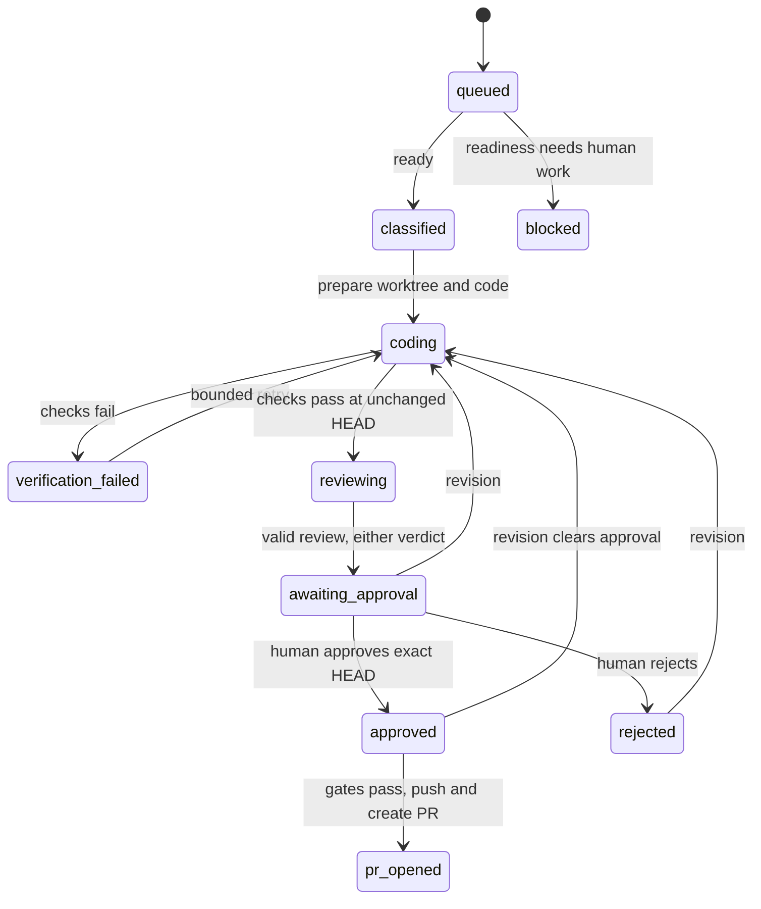

# Application state machines

This audit covers application-owned code in `apps/`, `packages/` and `scripts/`, including component demos. Licensed upstream components, framework internals, generated code, agent skill copies and captured request logs are outside its scope. Rows group related states rather than count individual booleans.

The decision: centralize task command policy and execution observation in [the pure core](../packages/core/src/task-controls.ts), use a reducer for concurrent member edits, and keep simple interactions local. No new state-machine runtime or database migration is needed. Effect continues to own execution, concurrency and traces.

The second pass (2026-11-25) applies the same decision to code added after the first audit: feature command policy is in [the pure core](../packages/core/src/feature-controls.ts), the backend guard and the feature page both read it, and `GetFeature` advertises it. Machines that already had one named type and one derivation stay as they are. [Known gaps](#known-gaps) lists what this pass found and did not change.

## Separate progress, ownership and actions

- **Task stage** is durable workflow progress and can outlive a crashed worker. Existing task JSON and its eleven stages remain compatible.
- **Execution phase** combines a run record with live backend ownership. `unavailable` means observation failed, not idle.
- **Action availability** advertises blockers and required inputs. It is advisory: commands acquire the existing lock and check live gates again.

The normal automated path is:



Diagram identifiers use underscores; stored stages retain hyphens. Failures and standalone step commands are additional paths. `withStage` stays a record update, not a global graph validator: enforcing only this graph would break valid manual/offline workflows. Readiness retains its priority (unsupported kind, then research, clarification, slicing, ready). Re-running a blocked verdict does not resolve its questions.

Execution follows `queued → running → finalizing → completed | failed`. An unfinished record without an owner is `interrupted`. A terminal record with an owner is still `finalizing`: flushing evidence and releasing the lock are part of completion. Evidence-close failure persists a failed run outcome. Nothing automatically replays.

## Workflow inventory

| Machine / source | States and transitions | Decision / invariant |
| --- | --- | --- |
| Project/profile — CLI, FS adapter, profile draft | absent → registered; missing/draft → approved or invalid | Validate at use. A profile draft never grants execution approval. Registration and host configuration remain distinct. |
| Intake — actions/backend | draft → submitting → task created → scheduled or start failed | Fixed partial success: redirect to the created task with a notice and explicit retry, rather than invite duplicate intake. |
| Readiness/classification — core/driver | unclassified → ready/research/clarification/slicing/unsupported; invalid output fails | Keep schema-derived priority. Verdicts describe facts, not live ownership. |
| Command policy — core/driver/scheduler | run/revise/approve/reject/open-pr allowed or blocked | Shared structural guards replace duplicated run/revision stage lists. Approved tasks can be revised before publication, clearing approval first. |
| Worktree — driver/git | absent → created/checked → edited → committed; preparation can fail | Keep canonical path, branch/common-repository and forbidden-path checks. Built-in protected paths (`.github/`, `.husky/`, `.githooks/`, `.claude/`, `.codex/`, `.agents/`, `AGENTS.md`, `CLAUDE.md`, `CODEOWNERS` in any folder, `.env`, `.env.*`; any letter case) are forbidden besides the profile's, checked on the whole branch diff including rename sources; `allow_protected_paths` on the task lifts them. Factory git calls ignore repository hooks (`core.hooksPath=/dev/null`). A worktree starts from the base branch commit, so a dirty checkout does not block it; uncommitted tracked changes get a note. Worktrees remain on the host. |
| Model attempt/ladder — driver/definitions | select rung → executing → completed/failed; checks can escalate | Keep bounded attempts and human-only rung exclusions. Unknown costs stay null. Failed model costs remain in evidence; not every thrown step currently has a task-level attempt row. |
| Verification — driver | unchecked → checking → passed/failed; result stale on HEAD change | Added unchanged-HEAD check across commands. Keep dirty/generated-file checks and commit-bound results. |
| Review — driver | verified HEAD → reviewing → valid review or failed call/output | Either valid verdict stops at human review. Request-changes is not human rejection. |
| PR draft — driver/core | absent/stale → drafting → current or unavailable | Optional and bound to HEAD. Writer failure never grants approval or blocks otherwise valid review. |
| Human decision — driver/core | awaiting → approved/rejected; stale when commit changes | Preserve exact reviewed HEAD and explicit blocking-findings acceptance. Recheck verification/review/approval before publishing. Push the exact approved SHA (`<sha>:refs/heads/<branch>`, never the branch name) and read the remote ref back; a ref that is not the approved SHA fails `openPr` and keeps the publication intent. |
| Revision — driver | eligible task → approval cleared → code/check/review | Shared eligibility includes approved. A failed revision cannot retain previous approval. Requires a note. |
| Feature — core/backend | grilling → spec → spec-approved → board → implementing → qa → done; any open stage → cancelled | One command table (`featureCommandBlockers`) replaces inline stage checks. `done` and `cancelled` accept no command. A step that ends after a cancel keeps its cost and text, not its stage. A failed QA step waits for a person; the loop does not pay for it again. |
| Feature ticket — core/backend | waiting / waiting-merge → running → done or failed; failed → running on retry | State follows the ticket's task. `ticketRetryable` and `ticketAwaitsMerge` name which tickets accept `retry-ticket` and `mark-merged`. An unknown ticket id is refused. |
| Tasks board — core/backend/web | backlog, todo, in_progress, in_review, done, blocked, cancelled; status follows the latest run when the run is newer | Keep `dropAction` as the one drop rule for board, menu and backend. Only In progress starts work; the factory alone moves work into In review and Blocked. |
| PR review — backend/core | no review → preparing → running → completed / failed / stopped / interrupted; a reply starts a new turn | Keep one derivation (`status`) from the turn files plus live ownership. A Stop that arrives after the turn ended no longer relabels a completed review as stopped. Every turn (kickoff, re-review, reply) starts only after the backend wrote the PR data into the run's `work` directory, and runs in an OS sandbox (writes to the review worktree and `work` only, no network, no `~/.ssh`, `~/.config/gh`, Keychains) without the PR's own settings or hooks; a failed fetch is named in the prompt and never blocks the turn. `AUTOMATED_TURN_DENY` is a hint, not a boundary: the sandbox is. |
| PR tending — core/backend | open → rerun / merge-base / answer-threads / fix-ci / wait → stopped or ended | Keep `nextTendAction` as the pure decision, with the bounded fix count. A thread waits only on a trusted comment (write, maintain or admin access, or `tending.trusted_logins`) newer than the last answer; tending's own replies never count. The backend filters the comments before the decision. |
| Agent pickup — core/backend | todo, unassigned → routed → assigned → started, or retry later | Keep `pickupPlan` pure and the retry delay. Routing asks once per task edit. |
| Agent chat — backend | idle → working → idle; `working` without a live reply reads as idle | Keep the in-process owner as the truth; a restart never leaves a chat working. |
| Memory fact — core | candidate → active after confirmations; any → dropped | Keep pure promotion and drop rules. |
| Publication — driver/GitHub | approved → push → external PR → stored PR | Explicit action, no automatic retry. External creation and local persistence are not atomic; inspect GitHub after an ambiguous failure. |

## Execution and storage inventory

| Machine / source | States and transitions | Decision / invariant |
| --- | --- | --- |
| Backend lifecycle — server/lifecycle/launcher | starting → accepting → draining → closed; startup may fail | Keep one root owner and idempotent shutdown that drains accepted work. Launcher stops only what it owns. |
| Command lock — FS/PG adapters | free → reserved/held → released; dead owner/lost session needs inspection | Hold from acceptance through evidence finalization. Snapshots do not prove the lock is free. Never auto-delete stale locks. |
| Scheduler — backend service | reservation → durable queued record/pointer → worker → finalization/release | Keep 32 accepted reservations, one Effect permit, durable acceptance before response and disconnect-independent work. |
| Run observation — core/backend/web | idle, queued, running, finalizing, completed, failed, interrupted, unavailable | Added derived phase without changing persisted states or legacy `running`/`state` fields. Validate persisted run metadata and fail closed. |
| Evidence — Evidence/storage | append/span start → flush → span end → close or failure | Preserve ordered logs, Effect traces and costs. Evidence finalization failure becomes run failure. |
| Evidence visibility — backend | visible → dismissed | Hide output tail independently of outcome/ownership. Retain artifacts and traces. |
| gRPC channel — client/protocol | absent → connected/reused → replaced/closed; auth/deadline/transport failure | Keep loopback/auth/deadlines; never fall back to CLI mutations. Action discovery is additive. |
| Subprocess — process adapter/diagnostics | spawning → streaming → exit/error/timeout | Keep bounded capture, full streaming, UTF-8 decoding and explicit spawn/stdin failures. No cancellation rewrite. |
| Model SDK/tool policy — Claude adapter/driver | request → streaming/result/error; none/read-only/edit capability | Preserve sandbox/tool guards. Capability mode is distinct from task progress. |
| Storage mode/init — data adapter | file or configured PG/S3; uninitialized → initializing → ready/failed → closed | Keep shared adapter selection/init and explicit failures. Never read stale file snapshots after activation. |
| Persistence — FS/PG adapters | validate → atomic write/transaction → snapshot | Keep runtime identities/schemas, atomic task writes and run/pointer transaction. No persisted task-union migration. |
| Artifact writer — data adapter | buffered → scheduled → serialized upload/index → drained or sticky failure | Keep bounded backlog, immutable chunks, checksums and upload-before-index. PG/S3 are not a distributed transaction; orphan objects are possible. |
| Migration — data migrate/scripts | unconfigured → locked/importing → verifying → activated or partial retry | Activate only after verification. Keep originals without dual writes; no migration on reads. |
| Data services/setup — scripts | missing/stopped → starting → healthy/error; install/link/update | Apps stay outside Docker. Data volumes persist independently of application processes. |

## UI inventory

| Machine / source | States and transitions | Decision / invariant |
| --- | --- | --- |
| Task detail — task page | loading/error → observed stage/owner/gates → command pending/result | Use shared policy. Poll only owned queued/running/finalizing work. Interrupted coding no longer spins forever. Unavailable observation disables commands. |
| Task run controls — task run | policy actions → run / revise / approve controls | The page now passes the run's cleanup record to the shared policy, so it no longer offers Run or Revise that the backend refuses after an uncertain cleanup. |
| Live run — run tab | polling → reload on a new page version → polling | The poll continues after a reload. Before, a reload that rendered the same version ended the loop and the spinner stayed. |
| Feature page — features | advertised actions → controls; working → auto-refresh | The page keeps no stage rules. It shows a control for each allowed action, the questions, ticket states and the QA plan, so every inbox item for a feature has its action on the page. A refused command keeps the typed answer. Cancel asks first. |
| Review list/chat — reviews | no review / preparing / running / ended; waiting for a new turn | `preparing` now disables New review and Remove, as the backend refuses them. A refused re-review shows its error, and a failed start ends the wait for a new turn. |
| Agent chat stream — chat transport | submitted → streaming → finished / stopped / lost | A step with no recorded result closes when the reply ends or stops. After about 30 s of failed polls the stream ends with an error, not an endless "streaming". |
| Forms — action form/task composers | draft → pending → result/error; revision success clears draft | Keep action-state feedback and pending controls. Separate intake partial success from total failure. |
| Member assignment — team edits/table | per member idle → optimistic pending → committed/rolled back | Reducer rolls back only the affected member, ignores stale responses, serializes same-member edits and handles thrown failures. Different members can save concurrently. |
| Team view — table | all/team/tag filter; query; grouped/flat; picker open/draft/selection | Keep independent local state. Explicit UTC date formatting avoids locale-dependent hydration changes. |
| Resources — app shell | loading → loaded/failed; navigation/refetch supersedes old response | Existing tagged load state and live-response guards stay local. |
| Project selection — shell/home | route → remembered valid project → first project | Keep route precedence and cookie/storage preference. Selection is not registration. |
| Sidebar — shell | desktop/narrow; closed/open drawer; idle/dragging resize; copy feedback | Keep focus return, Escape/navigation close and bounded stored width. |
| Health/status — health bridge/panel/status | checking → available/degraded/unreachable; refresh with last report | Fixed failed-check headline: it no longer remains “running” or claims fresh success. Keep timeouts and explicit unavailable results. |
| Chat composer/menus/pickers | editable → sending → sent/error; controlled/local values; recording → commit/discard | Keep synchronous send lock, preserved draft on failure, immutable payload and recording/send exclusion. Folder/app/model/approval choices remain independent. |
| Conversation scroll — task chat | pinned → user scrolled away → pinned | Follow new messages only when pinned; preserve user position. |
| Findings/checkpoints — agent components | filter/selection; focus/keyboard navigation | Local presentation state never drives backend workflow. |
| Catalog/demos — library and demo components | search/category/style/selection/reset; attachments/dictation; findings rounds; checkpoint reducer | Keep simulations isolated. Demo send/approval is not a production command. Upstream primitives retain their own interaction machines. |

## Agent action discovery

With the backend running:

```sh
factory task actions --project demo --id "$TASK_ID"
curl "http://localhost:3000/api/projects/demo/tasks/$TASK_ID/state"
```

The gRPC equivalent is `GetTaskControls(Target)`. Run `pnpm rpc:generate` after changing the protobuf service or core action schema to refresh the descriptor and HTTP JSON Schema. Responses use the core `TaskControls` schema: `task`, `execution`, optional `head_sha`/`diff_stat`/`gate_error`, and `actions[]` containing `action`, `allowed`, `blockers[{code,message}]`, and `requires[]`. Required inputs include `note`, `head` and conditional `accept_blocking`; discovery never supplies or accepts human input automatically.

Features use the same contract. `GetFeature` (project, feature id) returns the feature with `actions[]`: `action`, `allowed`, `blockers[{code,message}]`, `requires[]` (`text`, `tickets`, `ticket`) and, for `mark-merged` and `retry-ticket`, the `tickets` ids the command accepts now. Send the command with `FeatureAction`. Blocker codes are `stage`, `busy`, `answer-required`, `spec-missing`, `board-empty` and `ticket`.

Snapshots can change immediately. Submit the explicit command; on conflict, fetch again. Do not infer permission from stage alone, repeat intake after a scheduling failure, auto-resume interruption or automatically repeat ambiguous PR creation. The UI can present a subset of allowed commands (for example hiding a redundant run of a blocked verdict).

The normal suite covers every durable stage's high-level actions, ownership/unavailability, exact-head gates, approved revision, moving-HEAD verification, concurrent member failures, partial intake, interrupted UI and evidence finalization. `pnpm data:test` also exercises real PG/S3. These checks require no paid model calls or real GitHub publication.

## Third pass (2026-11-25)

This pass closed the gaps the second pass listed.

| Machine / source | States and transitions | Decision / invariant |
| --- | --- | --- |
| Run attention — core/backend/web | working, needs-you, waiting, done, closed | One rule, [`runAttention`](../packages/core/src/run-attention.ts), for the sidebar groups, the board card spinner and the home numbers. A live run always works. A `coding` or `reviewing` stage with no live run is interrupted and needs a person. An approved run with no pull request needs a person. `queued` and `classified` wait. The board task view carries `run.owned`. |
| Cross-project board — web | working, needs-me, in-review, ready, archived | Keeps its own columns: they also read the inbox and pull request state. "Ready" is the part of needs-you that has one clear step (open the pull request, merge). A failed task stays in Needs me when the inbox could not be read. |
| Task Details panel — web | watching → reload on a new page version | `RunWatch` polls while a run works, so the timeline updates outside the Run panel. |
| Feature cancel — core/backend | open stage → cancelled; live runs stop, other open runs are rejected | A second cancel returns the cancelled feature, not an error. A done feature still refuses cancel. Open pull requests stay. A run that could not be closed is named in the feature error. |
| Feature spec and board edit — web | view → edit → saved or refused | The page has controls for `save-spec` and `save-board`. Saving an approved specification returns it to `spec` for a new approval. The backend checks the board. |
| Issue title and description — web | view → edit → saved | The editor starts from the text on the page now, not the first render. |
| Inbox blocked item — core | text by workflow | An agent run continues from a comment. A pipeline run that is blocked before any code needs a new task. |

Stage predicates `coding | reviewing` and `rejected | pr-opened` now use core `runWorking` and `runFinished` in the backend, agent pickup and the task page.

## Fourth pass (2026-11-25)

This pass closed the last gaps.

| Machine / source | States and transitions | Decision / invariant |
| --- | --- | --- |
| Archive and delete guard — core/backend/web | held → refused; not held → archived | One rule, [`runHeld`](../packages/core/src/issues.ts): a live run holds its task, whatever the stage. An interrupted run at `coding` or `reviewing` can be archived with no reject first. A live revision of a failed run cannot. A queued turn is still refused. |
| Stage names — core/web | stage → label | One list, [`STAGE_LABELS`](../packages/core/src/run-attention.ts), for the board cards, the task page and the stage badge. Feature stages read `FEATURE_STAGE_LABELS` in [feature controls](../packages/core/src/feature-controls.ts). The tab glyph and the badge tone are different facts about a stage, each typed by `Stage`. |
| Cross-project board "Ready" — web | approved, no pull request → ready | The column reads `runNeed`. A test proves that each card in Needs me and Ready is a run that `runAttention` calls needs-you. The column stays: the vision defines it as "what can I finish". |

## Recovery: every non-final state has a rule

[`packages/backend/src/recovery.ts`](../packages/backend/src/recovery.ts) holds one table per record type, with one rule per state. Each table is `satisfies Record<State, RecoveryRule>`, so a state added later does not compile until it has a rule, and `recovery.test.ts` compares each table with its schema. A rule is one of:

- **final**: nothing to do.
- **idle**: nothing is in flight; a person's command starts it, and no inbox item is needed.
- **person**: a person acts, and an inbox item says so.
- **reconciler**: a named step moves it. `recover` marks the ones startup recovery runs; the others have an owner that runs on its own (the review sweeper, the feature ticker).

`BackendService.recover()` runs in this order: each task's latest run and older runs, then the project's feature tickets and `working` flags, then its review loops, then chats. A project or task it cannot read goes into the recovery report and is retried, as before. Features, loops and chats that fail to settle are logged and left to the detector.

### Run (`run.json` state)

| State | Rule | Note |
| --- | --- | --- |
| `queued` | reconciler `requeue` | Recovery queues the run again; if it cannot, it marks it interrupted. |
| `running` | reconciler `interrupt` | Marked interrupted with cleanup uncertain; a task at a working stage goes to `failed`. |
| `completed` | final | Settled. |
| `failed` | final | Settled. |
| `interrupted` | person | The task shows a failed or blocked item; a person runs it again. Uncertain cleanup waits for a confirm. |

A run that is `queued` or `running` but is **not** the task's latest run is settled as `interrupted` (cleanup uncertain if it was running) with the task stage unchanged: a newer run owns the task, so the stage is not this run's to change. Before this, nothing ever settled such a run. It is skipped while anything is queued or active for the task. Runs are listed from the run directories, so a PG/S3 installation has no listing and this step finds nothing there.

### Task stage

| Stage | Rule | Note |
| --- | --- | --- |
| `queued` | reconciler `requeue` | The task waits for its run; recovery queues a queued run again. |
| `classified` | idle | Waits for a person to start the run. |
| `blocked` | person | Inbox: blocked. |
| `coding` | reconciler `interrupt` | No live run: recovery moves the task to `failed`. |
| `verification-failed` | person | Inbox: failed. |
| `reviewing` | reconciler `interrupt` | No live run: recovery moves the task to `failed`. |
| `awaiting-approval` | person | Inbox: gate. |
| `approved` | idle | Waits for a person to open the pull request. |
| `rejected` | idle | Waits for a person to revise. |
| `pr-opened` | final | The review loop and PR tending own it from here. |
| `failed` | person | Inbox: failed. |

### PR review (turn state)

| State | Rule | Note |
| --- | --- | --- |
| `preparing` | final | Lives in memory only; a restart drops it. |
| `running` | reconciler `sweeper` | A turn with no live owner reads as interrupted; the sweeper stops one silent for 30 minutes. |
| `completed` | final | The findings reach the inbox as a review item. |
| `failed` | final | Settled. |
| `stopped` | final | Settled. |
| `interrupted` | reconciler `resume-loop` | A review that belongs to a review loop starts again, twice at most. Any other waits for a person to start a new one. |

### Review loop (`review-loop.json` state)

| State | Rule | Note |
| --- | --- | --- |
| `reviewing` | reconciler `resume-loop` | An interrupted review is started again (`resumed` counts it); after three interruptions the loop stops with a reason. |
| `fixing` | reconciler `settle-loop` | No queued or live run of the task: the loop stops with a reason (`recoverFixing`), the PR stays a draft, and the inbox gets a "stopped by recovery" item. The fix is not started again on its own: it may have pushed half a change, so a person sends the follow-up. |
| `ready` | final | The PR left draft. |
| `stopped` | idle | The reason is in the task activity; a person sends the follow-up again. |

The "stopped by recovery" inbox item lives in memory until the next start; the stopped state and its reason are stored.

### Feature stage and ticket state

| Feature stage | Rule | Note |
| --- | --- | --- |
| `grilling` | person | Inbox: question. |
| `spec` | person | Inbox: approve-spec. |
| `spec-approved` | idle | Waits for a person to write the board. |
| `board` | person | Inbox: approve-board. |
| `implementing` | reconciler `ticker` | The feature ticker starts and follows tickets on its own. |
| `qa` | person | Inbox: qa. |
| `done` | final | Settled. |
| `cancelled` | final | Settled. |

| Ticket state | Rule | Note |
| --- | --- | --- |
| `waiting` | reconciler `ticker` | The ticker starts it once its blockers are done. |
| `waiting-merge` | person | Inbox: merge. |
| `running` | reconciler `sync-ticket` | Follows its task: `done` at the approval gate or later, `failed` when the task failed, was blocked or rejected (its last event is the error), `running` while the task is active. A ticket whose task is gone, or that never got one, starts over as `waiting` with no task, so the ticker makes a new one. Recovery does this for every feature, not only those at `implementing`. |
| `done` | final | Settled. |
| `failed` | person | Inbox: failed. |

### The `working` flag

| Record | Rule | Note |
| --- | --- | --- |
| feature | reconciler `clear-working` | No execution holds the key: recovery clears the flag in storage and sets the feature error to "The backend stopped during this step. Run it again." so the inbox shows it. Reads still hide the flag. |
| chat | reconciler `clear-working` | No execution holds the key: recovery clears the flag in storage. Reads still hide it. |

### The stuck detector

Every 5 minutes (`FACTORY_STUCK_CHECK_MS`, default 300000; the timer is `unref`ed and `drain()` stops it) the backend looks for records whose state says someone works on them while nobody does, and which no write has touched for 60 minutes (`FACTORY_STUCK_AFTER_MS`, default 3600000):

- a latest run that is `queued` or `running` with no dispatcher owner (age: `created_at`);
- a review loop at `fixing` with nothing queued for the task, or at `reviewing` with no running or preparing review (age: the loop's `updated_at`);
- a feature `working` flag, or a ticket at `running`, that nothing holds (age: the step's start, or the task's last update);
- a chat reply nothing holds (age: the chat's `updated_at`).

Each one becomes an inbox item of kind `recovery` with a stable id (`stuck:<kind>:<project>:<id>[:<ticket>]:<state>:<since>`), and the id is written to stderr once. Records in a `person` state are not listed: they already have their own inbox item. A record younger than the threshold is not listed, and one that settles drops out at the next check. `BackendService.detectStuck(at)` runs one check with the clock set by the caller, which is how the tests avoid waiting.

## Known gaps

None in the state machines this audit covers. This is not a claim about the whole system: the [roadmap status](vision/roadmap.md#status) and the [architecture assessments](architecture-assessments/2026-11-26-ac0a5377.md) list what is still partial or planned.
