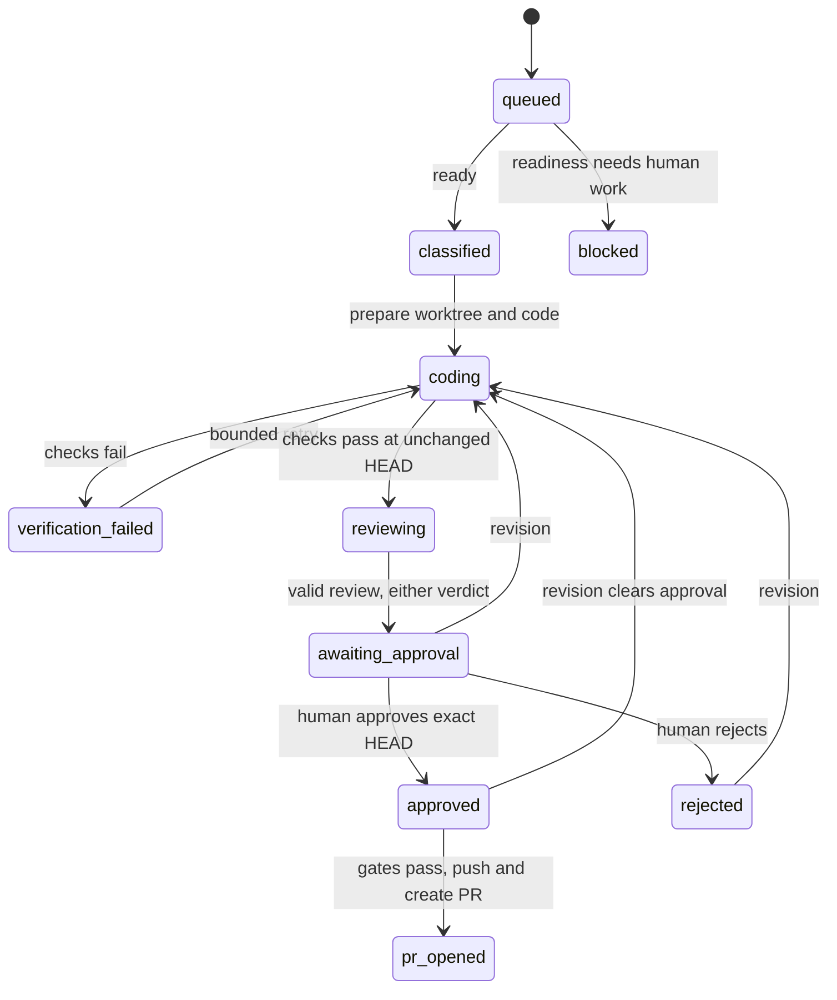

# Application state machines

This audit covers application-owned code in `apps/`, `packages/` and `scripts/`, including component demos. Licensed upstream components, framework internals, generated code, agent skill copies and captured request logs are outside its scope. Rows group related states rather than count individual booleans.

The decision: centralize task command policy and execution observation in [the pure core](../packages/core/src/task-controls.ts), use a reducer for concurrent member edits, and keep simple interactions local. No new state-machine runtime or database migration is needed. Effect continues to own execution, concurrency and traces.

## Separate progress, ownership and actions

- **Task stage** is durable workflow progress and can outlive a crashed worker. Existing task JSON and its eleven stages remain compatible.
- **Execution phase** combines a run record with live backend ownership. `unavailable` means observation failed, not idle.
- **Action availability** advertises blockers and required inputs. It is advisory: commands acquire the existing lock and check live gates again.

The normal automated path is:



Diagram identifiers use underscores; stored stages retain hyphens. Failures and standalone step commands are additional paths. `withStage` stays a record update, not a global graph validator: enforcing only this graph would break valid manual/offline workflows. Readiness retains its priority (unsupported kind, then research, clarification, slicing, ready). Re-running a blocked verdict does not resolve its questions.

Execution follows `queued → running → finalizing → completed | failed`. An unfinished record without an owner is `interrupted`. A terminal record with an owner is still `finalizing`: flushing evidence and releasing the lock are part of completion. Evidence-close failure persists a failed run outcome. Nothing automatically replays.

## Workflow inventory

| Machine / source | States and transitions | Decision / invariant |
| --- | --- | --- |
| Project/profile — CLI, FS adapter, profile draft | absent → registered; missing/draft → approved or invalid | Validate at use. A profile draft never grants execution approval. Registration and host configuration remain distinct. |
| Intake — actions/backend | draft → submitting → task created → scheduled or start failed | Fixed partial success: redirect to the created task with a notice and explicit retry, rather than invite duplicate intake. |
| Readiness/classification — core/driver | unclassified → ready/research/clarification/slicing/unsupported; invalid output fails | Keep schema-derived priority. Verdicts describe facts, not live ownership. |
| Command policy — core/driver/scheduler | run/revise/approve/reject/open-pr allowed or blocked | Shared structural guards replace duplicated run/revision stage lists. Approved tasks can be revised before publication, clearing approval first. |
| Worktree — driver/git | absent → created/checked → edited → committed; preparation can fail | Keep canonical path, branch/common-repository and forbidden-path checks. A worktree starts from the base branch commit, so a dirty checkout does not block it; uncommitted tracked changes get a note. Worktrees remain on the host. |
| Model attempt/ladder — driver/definitions | select rung → executing → completed/failed; checks can escalate | Keep bounded attempts and human-only rung exclusions. Unknown costs stay null. Failed model costs remain in evidence; not every thrown step currently has a task-level attempt row. |
| Verification — driver | unchecked → checking → passed/failed; result stale on HEAD change | Added unchanged-HEAD check across commands. Keep dirty/generated-file checks and commit-bound results. |
| Review — driver | verified HEAD → reviewing → valid review or failed call/output | Either valid verdict stops at human review. Request-changes is not human rejection. |
| PR draft — driver/core | absent/stale → drafting → current or unavailable | Optional and bound to HEAD. Writer failure never grants approval or blocks otherwise valid review. |
| Human decision — driver/core | awaiting → approved/rejected; stale when commit changes | Preserve exact reviewed HEAD and explicit blocking-findings acceptance. Recheck verification/review/approval before publishing. |
| Revision — driver | eligible task → approval cleared → code/check/review | Shared eligibility includes approved. A failed revision cannot retain previous approval. Requires a note. |
| Publication — driver/GitHub | approved → push → external PR → stored PR | Explicit action, no automatic retry. External creation and local persistence are not atomic; inspect GitHub after an ambiguous failure. |

## Execution and storage inventory

| Machine / source | States and transitions | Decision / invariant |
| --- | --- | --- |
| Backend lifecycle — server/lifecycle/launcher | starting → accepting → draining → closed; startup may fail | Keep one root owner and idempotent shutdown that drains accepted work. Launcher stops only what it owns. |
| Command lock — FS/PG adapters | free → reserved/held → released; dead owner/lost session needs inspection | Hold from acceptance through evidence finalization. Snapshots do not prove the lock is free. Never auto-delete stale locks. |
| Scheduler — backend service | reservation → durable queued record/pointer → worker → finalization/release | Keep 32 accepted reservations, one Effect permit, durable acceptance before response and disconnect-independent work. |
| Run observation — core/backend/web | idle, queued, running, finalizing, completed, failed, interrupted, unavailable | Added derived phase without changing persisted states or legacy `running`/`state` fields. Validate persisted run metadata and fail closed. |
| Evidence — Evidence/storage | append/span start → flush → span end → close or failure | Preserve ordered logs, Effect traces and costs. Evidence finalization failure becomes run failure. |
| Evidence visibility — backend | visible → dismissed | Hide output tail independently of outcome/ownership. Retain artifacts and traces. |
| gRPC channel — client/protocol | absent → connected/reused → replaced/closed; auth/deadline/transport failure | Keep loopback/auth/deadlines; never fall back to CLI mutations. Action discovery is additive. |
| Subprocess — process adapter/diagnostics | spawning → streaming → exit/error/timeout | Keep bounded capture, full streaming, UTF-8 decoding and explicit spawn/stdin failures. No cancellation rewrite. |
| Model SDK/tool policy — Claude adapter/driver | request → streaming/result/error; none/read-only/edit capability | Preserve sandbox/tool guards. Capability mode is distinct from task progress. |
| Storage mode/init — data adapter | file or configured PG/S3; uninitialized → initializing → ready/failed → closed | Keep shared adapter selection/init and explicit failures. Never read stale file snapshots after activation. |
| Persistence — FS/PG adapters | validate → atomic write/transaction → snapshot | Keep runtime identities/schemas, atomic task writes and run/pointer transaction. No persisted task-union migration. |
| Artifact writer — data adapter | buffered → scheduled → serialized upload/index → drained or sticky failure | Keep bounded backlog, immutable chunks, checksums and upload-before-index. PG/S3 are not a distributed transaction; orphan objects are possible. |
| Migration — data migrate/scripts | unconfigured → locked/importing → verifying → activated or partial retry | Activate only after verification. Keep originals without dual writes; no migration on reads. |
| Data services/setup — scripts | missing/stopped → starting → healthy/error; install/link/update | Apps stay outside Docker. Data volumes persist independently of application processes. |

## UI inventory

| Machine / source | States and transitions | Decision / invariant |
| --- | --- | --- |
| Task detail — task page | loading/error → observed stage/owner/gates → command pending/result | Use shared policy. Poll only owned queued/running/finalizing work. Interrupted coding no longer spins forever. Unavailable observation disables commands. |
| Forms — action form/task composers | draft → pending → result/error; revision success clears draft | Keep action-state feedback and pending controls. Separate intake partial success from total failure. |
| Member assignment — team edits/table | per member idle → optimistic pending → committed/rolled back | Reducer rolls back only the affected member, ignores stale responses, serializes same-member edits and handles thrown failures. Different members can save concurrently. |
| Team view — table | all/team/tag filter; query; grouped/flat; picker open/draft/selection | Keep independent local state. Explicit UTC date formatting avoids locale-dependent hydration changes. |
| Resources — app shell | loading → loaded/failed; navigation/refetch supersedes old response | Existing tagged load state and live-response guards stay local. |
| Project selection — shell/home | route → remembered valid project → first project | Keep route precedence and cookie/storage preference. Selection is not registration. |
| Sidebar — shell | desktop/narrow; closed/open drawer; idle/dragging resize; copy feedback | Keep focus return, Escape/navigation close and bounded stored width. |
| Health/status — health bridge/panel/status | checking → available/degraded/unreachable; refresh with last report | Fixed failed-check headline: it no longer remains “running” or claims fresh success. Keep timeouts and explicit unavailable results. |
| Chat composer/menus/pickers | editable → sending → sent/error; controlled/local values; recording → commit/discard | Keep synchronous send lock, preserved draft on failure, immutable payload and recording/send exclusion. Folder/app/model/approval choices remain independent. |
| Conversation scroll — task chat | pinned → user scrolled away → pinned | Follow new messages only when pinned; preserve user position. |
| Findings/checkpoints — agent components | filter/selection; focus/keyboard navigation | Local presentation state never drives backend workflow. |
| Catalog/demos — library and demo components | search/category/style/selection/reset; attachments/dictation; findings rounds; checkpoint reducer | Keep simulations isolated. Demo send/approval is not a production command. Upstream primitives retain their own interaction machines. |

## Agent action discovery

With the backend running:

```sh
factory task actions --project demo --id "$TASK_ID"
curl "http://localhost:3000/api/projects/demo/tasks/$TASK_ID/state"
```

The gRPC equivalent is `GetTaskControls(Target)`. Run `pnpm rpc:generate` after changing the protobuf service or core action schema to refresh the descriptor and HTTP JSON Schema. Responses use the core `TaskControls` schema: `task`, `execution`, optional `head_sha`/`diff_stat`/`gate_error`, and `actions[]` containing `action`, `allowed`, `blockers[{code,message}]`, and `requires[]`. Required inputs include `note`, `head` and conditional `accept_blocking`; discovery never supplies or accepts human input automatically.

Snapshots can change immediately. Submit the explicit command; on conflict, fetch again. Do not infer permission from stage alone, repeat intake after a scheduling failure, auto-resume interruption or automatically repeat ambiguous PR creation. The UI can present a subset of allowed commands (for example hiding a redundant run of a blocked verdict).

The normal suite covers every durable stage's high-level actions, ownership/unavailability, exact-head gates, approved revision, moving-HEAD verification, concurrent member failures, partial intake, interrupted UI and evidence finalization. `pnpm data:test` also exercises real PG/S3. These checks require no paid model calls or real GitHub publication.
