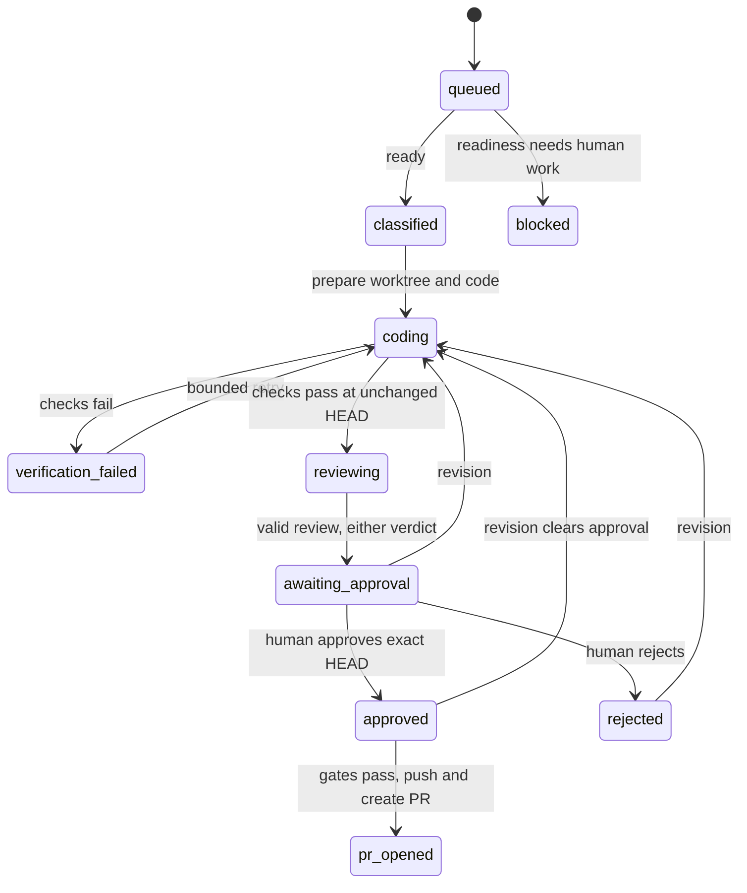

# Task stages

Part of [the state-machine index](../state-machines.md).

The normal automated path is:

Diagram identifiers use underscores; stored stages retain hyphens. Failures and standalone step commands are additional paths. `withStage` stays a record update, not a global graph validator: enforcing only this graph would break valid manual/offline workflows. Readiness retains its priority (unsupported kind, then research, clarification, slicing, ready). Re-running a blocked verdict does not resolve its questions.

| Machine / source | States and transitions | Decision / invariant |
| --- | --- | --- |
| Intake — actions/backend | draft → submitting → task created → scheduled or start failed | Fixed partial success: redirect to the created task with a notice and explicit retry, rather than invite duplicate intake. |
| Readiness/classification — core/driver | unclassified → ready/research/clarification/slicing/unsupported; invalid output fails | Keep schema-derived priority. Verdicts describe facts, not live ownership. |
| Command policy — core/driver/scheduler | run/revise/approve/reject/open-pr allowed or blocked | Shared structural guards replace duplicated run/revision stage lists. Approved tasks can be revised before publication, clearing approval first. |
| Revision — driver | eligible task → approval cleared → code/check/review | Shared eligibility includes approved. A failed revision cannot retain previous approval. Requires a note. |
| Stage names — core/web | stage → label | One list, [`STAGE_LABELS`](../../packages/core/src/run-attention.ts), for the board cards, the task page and the stage badge. Feature stages read `FEATURE_STAGE_LABELS` in [feature controls](../../packages/core/src/feature-controls.ts). The tab glyph and the badge tone are different facts about a stage, each typed by `Stage`. |
| Inbox blocked item — core | text by workflow | An agent run continues from a comment. A pipeline run that is blocked before any code needs a new task. |
