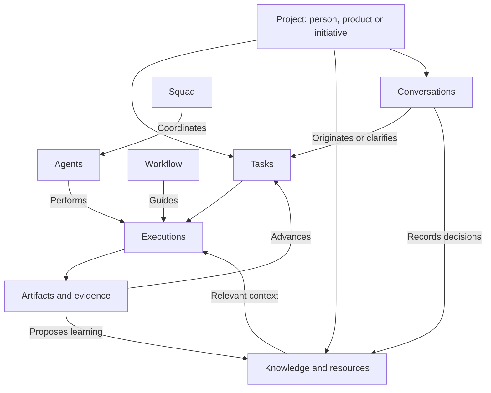
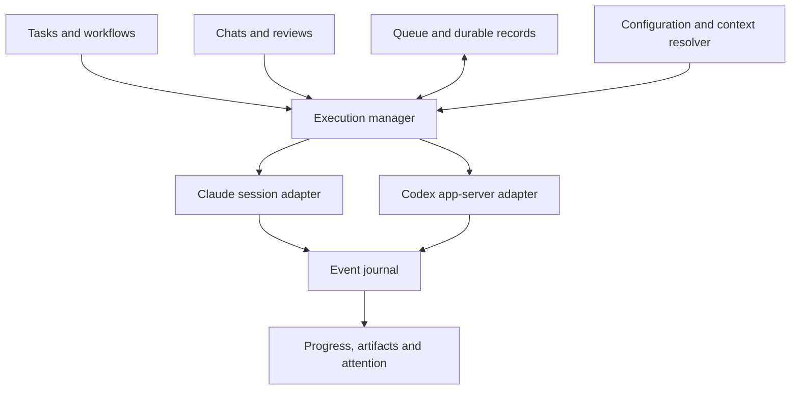
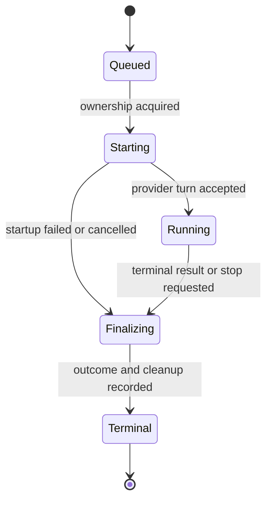

# Factory: Product Vision and Agent Runtime Design

**Design draft · 24 November 2026 · v0.1**

This document consolidates the product direction discussed with José and proposes an implementation plan for Claude Code and Codex integration. It does not describe features as implemented unless explicitly identified as current behavior. No application code has been changed for this document.

## 1. Product vision

> Factory is a workspace for organizing and doing my work with agents. Tasks express commitments, projects preserve the context around people, products and initiatives, and conversations help turn intentions into results. I can choose how much to direct and how much to delegate.

The central object is the **task**. Software development is an important workflow, while the same workspace also supports management, research, planning and writing without requiring a repository.

The main screen should answer three questions: **What needs me? What is progressing? What can I review?**

### Direction established in the discussion

- Tasks are the central unit of work, analogous to issues in Multica.
- Projects can represent people: José, each direct report and the manager can each have a project.
- Other project types include products and initiatives.
- Repositories are optional resources attached to projects.
- The current primary use case is working collaboratively with agents. Complete delegation is an additional mode to develop.
- Shared knowledge and task history should make subsequent work better informed.

### Proposed design choices to validate

- Separate user accounts from the people represented by projects.
- Give a task one primary project and optional related projects.
- Separate responsibility for the result from the current executor.
- Make conversations first-class records that can originate tasks and decisions.
- Introduce squads only when recurring collaboration justifies them.
- Use one execution manager for tasks, chats and reviews.

## 2. Principles

1. **Start with the work.** A task can be captured before choosing an agent, workflow or execution environment.
2. **Context belongs to its scope.** Project facts remain available to relevant agents without duplicating an independent copy for each agent.
3. **Collaboration and delegation coexist.** The user can participate, clarify, review or delegate within the same task.
4. **Progress requires evidence.** A successful provider turn does not by itself complete a task.
5. **Execution must be observable and controllable.** Starting, steering, interrupting and resuming should have explicit meanings.
6. **Capabilities are explicit.** Show what tools, instructions and permissions an execution actually receives.
7. **History is preserved; current knowledge evolves.** Replaced decisions remain explainable without remaining active instructions.

Primary product metric: **human attention minutes per accepted outcome**, paired with quality and rework measures. Token and cost metrics support diagnosis; they do not establish value on their own.

## 3. Domain model

| Concept | Meaning | Important distinctions |
| --- | --- | --- |
| Project | A durable context for a person, product or initiative | Does not require a repository or a completion date |
| Task | A desired outcome or commitment | Can be manual, assisted or delegated |
| Conversation | An interaction that develops understanding or advances work | May exist before a task and link to several tasks |
| Knowledge item | A fact, constraint or accepted decision considered current | Has provenance, scope and validity |
| History event | Something that occurred | Preserved even when its conclusion is superseded |
| Resource | A repository, document, external reference or connected service | A reference does not automatically grant execution access |
| Agent | A persistent collaborator configuration | Identity and instructions are separate from model and process |
| Skill | A reusable procedure | Can be used across projects and agents |
| Squad | A reusable group with a coordinator | Defines collaborators, not necessarily a fixed process |
| Workflow | Steps, handoffs and completion conditions | Defines the procedure rather than the participants alone |
| Execution | One managed attempt to advance work | Has ownership, context, events and an outcome |
| Provider session | Provider-native conversation continuity | May span multiple executions; is not project memory |
| Artifact | A concrete output, such as a document, patch or report | Can be reviewed independently of the execution transcript |
| Attention item | A request for user action | Resolving a notification does not implicitly approve work |



### Projects representing people

A project about Ana contains work and context concerning Ana. A task in that project can still be assigned to José or an agent. Ana does not need an account, and the existence of the project grants her no access to its notes.

“My tasks” is a cross-project view; “José” is a project. They must not become interchangeable.

| Type | Useful default presentation |
| --- | --- |
| Person | Agreements, next meetings, goals, notes and related tasks |
| Product | Priorities, decisions, resources and active work |
| Initiative | Target outcome, milestones, dependencies and optional due date |

People projects are ongoing contexts. Do not show a person as “80% complete.” Product and initiative progress should be attached to meaningful goals or milestones.

### Tasks, epics and plans

A task has a title, description, acceptance criteria, status, priority, primary project, related projects, accountable owner, current assignee, comments and artifacts. Parent-child relationships represent larger work, with dependencies between tasks where needed.

An epic is a larger work item with its own acceptance criteria. Completing every child task does not automatically prove the parent outcome. A plan is a revisable proposal for decomposition and ordering; creating a plan is distinct from executing it.

Task size and autonomy are independent. A small ticket can be fully delegated; a large epic can be developed collaboratively.

Keep task progress separate from execution state. “In review” describes work; “starting,” “running” or “interrupted” describes an attempt. Workflow-specific development steps should not become universal task statuses.

## 4. Knowledge and context

| Layer | Purpose | Example |
| --- | --- | --- |
| Current knowledge | What is considered true or agreed | Each invoice corresponds to one transfer |
| Historical memory | What happened and why | Partial payments were excluded from the initial scope |
| Procedural knowledge | How work is performed | A skill for preparing a 1:1 |
| Execution context | Information selected for the current attempt | Relevant agreements, task specification and source documents |

Knowledge items should record source, scope, validation status, timestamps and supersession links. Agent inferences should be distinguishable from confirmed decisions. Comments and transcripts are evidence; they do not automatically become permanent rules.

Proposed promotion flow: conversation or execution finding → proposed knowledge → confirmation where needed → current project knowledge. Low-risk automatic promotion policies can be added later.

The context assembler selects relevant information within access and size limits. Each execution retains a manifest of the source versions it used. A resumed provider session is a convenience for continuity, not the authoritative store of task requirements or project facts.

## 5. Core user journeys

### Prepare a direct report's 1:1

Open the person's project, create a preparation task and select relevant agreements. An agent drafts an agenda. José reviews it, conducts the meeting, records new agreements and creates follow-up tasks. The task can complete with an approved agenda; subsequent meeting notes are linked evidence rather than silently changing the original deliverable.

### Implement a ticket collaboratively

Open a product task and choose an agent. Factory prepares its worktree and execution context. José can provide additional instructions while work proceeds, inspect artifacts, interrupt when necessary and continue the conversation. Verification and approval apply to the actual result being reviewed.

### Delegate a feature

Define an outcome and acceptance criteria. A coordinator proposes a plan and child tasks. After any required plan approval, it schedules work within limits, tracks dependencies and escalates ambiguity. Final verification checks the parent outcome, not just child status counts.

### Navigation

Start with Inbox, Tasks, Projects and Conversations. Expose Agents and execution details as working tools. Skills, integrations and runtime configuration belong in configuration surfaces. Squads, scheduled automations and expanded analytics can follow demonstrated demand.

## 6. Runtime review: evidence and limits

The preceding review inspected Factory's local source and Multica's public source on 24 November 2026. It did not execute either system, inspect live credentials or establish the version installed on the user's server. Multica references below point to its moving main branch; implementation work must pin a source revision and supported CLI versions before relying on protocol details.

### Current Factory observations

| Area | Observed behavior | Consequence |
| --- | --- | --- |
| Claude tasks | Agent SDK calls with guards, sandbox settings, cancellation, budgets and timers | Useful controls already exist and should be retained |
| Claude reviews | Separate CLI adapter and detached process launch | Lifecycle and configuration differ from task execution |
| Codex | `codex exec --json`, including optional resume and output schema | Good batch primitive; current wrapper lacks bidirectional session control |
| Persistence | Claude session persistence is opt-in; review chats resume sessions | The task workflow does not establish comparable session continuity |
| Configuration | Claude SDK excludes settings sources; review CLI loads project settings; Codex ignores user config and disables selected features | Provider behavior differs by entry point |
| Cancellation | Foreground process runner escalates termination; detached stop helper sends SIGTERM | Cleanup guarantees differ |
| Events | Shared tool events omit call IDs | Concurrent tool activity cannot reliably be correlated |
| Codex activity | stdout and stderr enter the same callback; any output updates activity | Logs can look like progress; stream framing is fragile |
| Claude retries | Rate-limit retry uses `!error.costUsd` | Unknown cost is treated like zero; neither proves absence of side effects |
| Capability model | Codex is marked unable to screen tool calls; guarded coding calls are refused | Capabilities describe the current adapter and must not be treated as timeless provider facts |

The older local execution review is historical evidence, not a current checklist: budgets, timers and other controls have since been added.

### What to adopt from Multica

Multica's Codex backend uses app-server over stdio, with explicit initialization, thread and turn handling, interruption and resume recovery [M1]. Its Claude backend uses streaming JSON in both directions and keeps stdin open for control responses [M2]. Its shared session interface includes optional supplemental input, tool activity and terminal-result boundaries [M3].

Its runtime documentation describes machine-level execution, explicit configuration inheritance and warm-process reuse [M4]. These are reference patterns, not requirements to reproduce its entire distributed architecture.

Multica's default permission model is broader than Factory's guarded task path: its documented default permits host-level execution and relies on an external isolation boundary [M5]. Adopt its lifecycle ideas while explicitly designing Factory's own permission policy.

## 7. Proposed execution architecture

All task, chat, review and future automation execution should pass through one execution manager. Provider-specific transports remain behind adapters. Initially this can live in the existing local backend; a separate machine daemon is optional future deployment work.



### Responsibilities

- **Execution manager:** accepts work durably, acquires ownership, applies concurrency limits, starts sessions, routes input and manages cancellation and finalization.
- **Provider adapter:** implements the native protocol, declares supported capabilities and normalizes events without discarding essential identifiers.
- **Configuration resolver:** resolves instruction sources, tools, skills, model choices, environment references and enforceable permissions before launch.
- **Event journal:** stores ordered observations and checkpoints, including usage and cleanup evidence.
- **Context assembler:** selects task and project knowledge and records provenance.

Do not expose raw native session IDs as the identity of a Factory task or conversation. Switching providers creates a new provider session with an explicit handoff summary; Claude and Codex sessions are not interchangeable.

## 8. Session and execution contracts

The following is a conceptual API, not a claim about either vendor's SDK signatures:

```typescript
interface ProviderAdapter {
  inspect(): Promise<RuntimeCapabilities>;
  open(config: EffectiveExecutionConfig,
       resume?: ProviderSessionRef): Promise<ProviderSession>;
}

interface ProviderSession {
  startTurn(input: TurnInput): Promise<TurnHandle>;
  close(): Promise<CleanupResult>;
}

interface TurnHandle {
  events: AsyncIterable<ExecutionEvent>;
  result: Promise<TurnResult>;
  supplement?: (input: SupplementalInput) => Promise<DeliveryReceipt>;
  interrupt(reason: string): Promise<InterruptionReceipt>;
}
```

Capabilities are negotiated from provider, CLI version, adapter and execution policy. Unsupported actions must be explicit. Supplement delivery must return whether input was accepted for the current turn, queued for a later turn or rejected; the UI must not claim delivery merely because a user clicked Send.

Keep disposable sessions for bounded classification and formatting calls. Persist sessions for continuing implementation, research and review conversations. Do not share mutable sessions concurrently between unrelated tasks.

### Durable records

| Record | Required information |
| --- | --- |
| Execution | Factory ID, task/conversation link, agent, parent execution, owner generation, state, timestamps, config hash and context manifest |
| Provider session | Provider, native ID, runtime/account reference, work directory, continuity scope, last use and validity |
| Turn | Native turn ID where available, input ID, input acceptance, session link and terminal outcome |
| Event | Execution ID, sequence, provider event identity where available, timestamp, type, tool-call ID, parent-call ID and payload |
| Usage checkpoint | Provider/model, cumulative or incremental semantics, token categories, reported versus estimated cost and completeness |
| Cleanup | Requested stop, native acknowledgement, process exit, descendant cleanup and any uncertainty |

Credential values are excluded from these records. Store references and redacted configuration manifests.

## 9. Codex implementation plan

1. **Introduce app-server behind the existing provider boundary.** Keep the batch adapter during migration for verified one-shot workloads.
2. **Implement transport ownership.** Launch the supported binary, keep stdin open, parse protocol stdout independently from diagnostic stderr, correlate request IDs and bound startup requests.
3. **Implement initialization and continuity.** Initialize, start or resume a thread, capture the session identity early, then start a turn. Persist associations before treating the turn as fully managed.
4. **Normalize streaming events.** Preserve native item/tool IDs, text deltas, tool starts/results, terminal status and usage. Unknown events remain diagnosable and must not fabricate progress.
5. **Add interruption.** Request native turn interruption, wait a bounded period, then escalate process termination if needed. Record cleanup separately from outcome.
6. **Handle failed resume explicitly.** Distinguish a rejected or unavailable session from a broken transport. Starting fresh requires an explicit continuity notice and a reconstruction from durable task context. Do not silently claim that the conversation was resumed.
7. **Implement supplemental input only against verified protocol support.** Negotiate the capability, verify acknowledgement semantics and serialize messages against turn completion.
8. **Revisit policy capabilities.** App-server control does not automatically equal Claude's tool-guard behavior. Add enforcement only after testing supported approval requests and sandbox behavior against the project's required controls.

Exact request shapes, transport framing, supported flags and lifecycle events must be validated against the selected Codex CLI version using its available protocol schema and real integration tests. Multica's implementation is comparative evidence, not the protocol specification.

## 10. Claude implementation plan

Retain the Agent SDK as the preferred integration initially. The architectural issue is the split execution path, not the presence of an SDK.

- Extend the SDK adapter behind the same managed session contract used for Codex.
- Move reviews from detached shell launches into the execution manager.
- Use the supported SDK streaming-input and interruption mechanisms where available; advertise supplemental input only after verifying the installed SDK/CLI combination.
- Preserve SDK guards, sandbox controls and budget enforcement when consolidating paths.
- Explicitly persist continuing sessions and save their IDs early. Keep disposable calls opt-in by workload policy.
- Preserve tool-call and parent-call IDs when translating SDK events.
- Distinguish authoritative provider completion from subsequent stream or process cleanup.
- Replace cost-based retry inference with observed execution evidence.

If the supported SDK cannot provide a required lifecycle capability, evaluate a direct streaming-JSON adapter as a bounded fallback. Avoid maintaining two independent policy engines for the same provider.

## 11. Effective configuration and permissions

Every execution should have a reviewable manifest: provider and binary version, model, effort, work directory, instruction sources, enabled skills, MCP tools, environment variable names, credential references, limits and policy.

Proposed configuration precedence: application defaults → runtime defaults → agent configuration → project configuration → explicit execution overrides. This precedence applies to ordinary settings. Permission restrictions combine conservatively; a lower-trust instruction or override cannot silently widen granted authority.

Instruction composition is separate: application behavior, agent responsibilities, project context and task instructions should each retain their source. Avoid placing identical content in both instruction files and appended prompts.

Distinguish three permission questions:

1. Who may invoke this agent?
2. Which project information may this execution read?
3. Which tools and external actions may it perform?

Provide explicit inheritance modes, such as managed configuration and selected local capabilities. Show inherited tools and allow disabling them. Resolve local credentials on the runtime host; never copy secrets into prompts or knowledge records.

Changing agent configuration affects new executions. Continuing a session with changed instructions requires a defined refresh or restart policy and a recorded configuration version. Warm-process reuse must not retain stale credentials or instructions.

## 12. Lifecycle, cancellation and recovery



The terminal record separately stores outcome—completed, failed, cancelled or interrupted—and cleanup status. An unresolved cleanup keeps a resource lock or quarantine even if the user-facing outcome is known. A completed provider result must not later be mislabeled as a model hang because cleanup was slow.

Cancellation is a request followed by acknowledgement. First use native interruption, then bounded process-group termination, then escalation where supported. Do not announce that work has stopped before the system has evidence of that fact.

Maintain separate startup, semantic inactivity and active-tool limits. Diagnostic output must not indefinitely renew progress. A long-running tool needs its own accounting; machine sleep must be considered before interpreting elapsed silence.

On restart, reconcile durable records with worker ownership and process evidence. Queued work that never started may be scheduled again. Running work with uncertain effects becomes interrupted pending reconciliation. PID existence alone is insufficient proof of ownership; use execution identity and an ownership generation or equivalent fencing mechanism.

Provider resume restores conversation context; it does not roll back files or prove whether external actions completed. Reconcile worktree changes, artifacts and external operations before retrying uncertain work.

### Retry policy

| Failure | Proposed behavior |
| --- | --- |
| Rate limit before confirmed turn acceptance and before tool activity | Bounded retry with backoff |
| Missing binary or authentication | Actionable blocked state; no repeated blind retry |
| Resume rejected | Offer or perform explicitly configured fresh-session recovery with context reconstruction |
| Transport failure after possible tool activity | Preserve evidence and reconcile; no automatic replay |
| Backend interruption | Reconcile ownership and partial results before continuing |
| Provider completed, cleanup uncertain | Keep outcome; block conflicting replacement work until cleanup is resolved |

Unknown cost remains unknown. Zero billing is not evidence of zero side effects.

## 13. Scheduling, observability and budgets

Use one scheduler across tasks, chats, reviews and child executions. Enforce limits for the machine, provider/account and agent, plus work-directory exclusivity where concurrent writes conflict. A parent waiting for delegated children must not hold the only capacity needed to run those children.

Journal provider events in sequence with deduplication where identifiers permit it. Keep stdout protocol data and stderr diagnostics separate. Bound payload retention and redact credentials. Preserve final artifacts independently from transcript retention.

Record live usage checkpoints when available. Identify whether counters are session-cumulative or turn-local before aggregating; repeated cumulative snapshots must not be billed twice. Display provider-reported cost, estimated cost and unavailable cost distinctly.

Support hard provider budgets where enforceable. Otherwise show that a cost budget is estimated and use explicit time/token controls where supported. Do not promise dollar enforcement for a provider integration that cannot deliver it.

Diagnostic metrics: startup latency, time to first meaningful event, execution duration, cancellation latency, resume success, tool failures, unknown outcomes, usage completeness and queue wait. Product metrics: accepted outcomes, review effort and rework.

## 14. Migration plan

| Phase | Work | Exit criterion |
| --- | --- | --- |
| 0: Baseline | Pin Factory revision, CLI/SDK versions and reference behavior; capture sanitized protocol fixtures | Existing paths have documented behavior and reproducible lifecycle checks |
| 1: Shared contract | Add execution/session identity, event IDs, separate stderr and retry evidence; retain current transports | All adapters emit the same lifecycle vocabulary without losing native detail |
| 2: Codex prototype | Implement app-server start/resume/stream/interrupt behind a feature flag | Continuity, cancellation and failure scenarios pass against supported CLI versions |
| 3: Claude consolidation | Route review and chat execution through the managed SDK path | No review-specific detached-process lifecycle remains for migrated work |
| 4: Durable operations | Add configuration manifests, recovery, shared limits and usage checkpoints | Restart and concurrent-work tests preserve ownership and avoid duplicate side effects |
| 5: Product generalization | Optional repository resources, person projects, task/conversation links and non-code artifacts | The three core user journeys work without repository assumptions |
| Later | Warm pools, remote runtimes, squads and advanced autonomy | Added only after baseline lifecycle reliability and measured need |

Keep old execution history readable. Route existing provider sessions through their compatible adapter until migrated or explicitly restarted. Feature flags allow rollback for new work; they must not rewrite session identity or silently switch providers. Never start old and new workers on the same mutable session or worktree simultaneously.

## 15. Acceptance tests

| Scenario | Expected result |
| --- | --- |
| Follow-up after completed turn | Same valid provider session resumes; Factory retains distinct executions |
| Additional input during execution | Provider acknowledgement or explicit queue/rejection is visible; no false delivery confirmation |
| Cancel during model output | Native interruption is attempted and final state is recorded |
| Cancel during a shell tool | Descendants are stopped or cleanup is reported uncertain; conflicting work stays blocked |
| Restart after durable acceptance | Unstarted work remains recoverable |
| Restart after possible side effect | No blind replay; evidence supports reconciliation |
| Resume transcript missing | Fresh start is explicit and receives reconstructed task context |
| Stderr noise with no progress | Noise does not indefinitely prevent stall handling |
| Quiet but active tool | Tool-specific timeout applies rather than an undifferentiated silence timer |
| UTF-8 and protocol frames split across chunks | Parser preserves content and message boundaries |
| Repeated usage snapshots | Totals are not double-counted |
| Rate limit with unknown cost | No automatic assumption that work was side-effect-free |
| Concurrent work in one writable directory | Conflicting execution is serialized or isolated |
| Permission request unsupported by adapter | Explicit refusal or attention request; no silent broadening |
| Configuration changed before follow-up | Effective settings are refreshed or session restart is explicit |
| Non-repository task | Can produce a reviewed document or research result |

Use unit tests for protocol parsing and state transitions, process fixtures for interruption and stream behavior, and a small opt-in real-provider integration suite. Record CLI versions and costs for real runs. No live-provider tests were performed for this document.

## 16. Decisions still open

- Is Factory single-user initially, with people represented as projects, or immediately collaborative?
- Which actions should run autonomously and which require review, by project and workflow?
- How should person-project notes be shared when another person becomes a workspace member?
- Which local skills and integrations should be inherited by default?
- How long should provider sessions, raw events and artifacts be retained?
- Should remote execution be supported soon, or should the manager remain local first?
- When should a conversation create a task automatically versus propose one?
- What is the smallest useful initial agent set, and when is a squad justified?

These questions do not block a session-management prototype. They should be resolved before expanding access or automation defaults.

## 17. Evidence and implementation references

### Factory source reviewed

Root: this repository.

- `VISION.md`, `CONTEXT.md`, `GLOSSARY.md`, `docs/vision/entities.md`: existing repository-centered vision and terminology.
- `packages/core/src/schemas.ts`: required repository fields and coding-oriented task stages.
- `packages/core/src/agents.ts`: provider capabilities, shared events and headless CLI contract.
- `packages/core/src/ports.ts`: model requests, resume and persistence options.
- `packages/adapters-codex/src/index.ts`: batch execution, parser and timers.
- `packages/adapters-claude/src/index.ts`: SDK configuration, guards, retry and limits.
- `packages/adapters-claude/src/cli.ts`: review CLI configuration and event translation.
- `packages/adapters-process/src/index.ts`: foreground and detached process lifecycle.
- `packages/backend/src/reviews.ts`: review launch, session discovery and stopping.
- `packages/driver/src/workflow.ts`: guarded coder workflow.
- `docs/agent-execution-review.md`: older analysis; individual findings require current-source confirmation.

### Multica references

- [M1: Codex backend](https://github.com/multica-ai/multica/blob/main/server/pkg/agent/codex.go)
- [M2: Claude backend](https://github.com/multica-ai/multica/blob/main/server/pkg/agent/claude.go)
- [M3: Shared agent/session contract](https://github.com/multica-ai/multica/blob/main/server/pkg/agent/agent.go)
- [M4: Daemon and runtimes](https://github.com/multica-ai/multica/blob/main/apps/docs/content/docs/daemon-runtimes.mdx)
- [M5: Security model](https://github.com/multica-ai/multica/blob/main/apps/docs/content/docs/security-model.mdx)

The supplied screenshots additionally informed the product discussion about agents, skills, runtime inheritance, squads, projects and Inbox. The proposed Factory design is original synthesis; it is not a description of Multica's internal domain schema.
